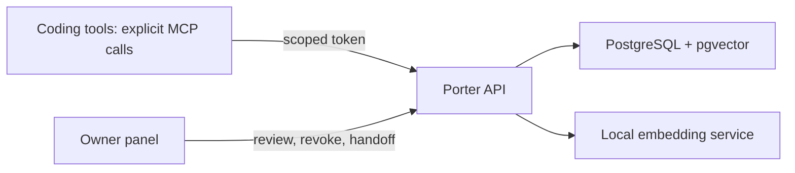

<p align="center">
  <a href="README.md"><b>English</b></a> &nbsp;|&nbsp; <a href="README.zh-CN.md">中文</a>
</p>

<h1 align="center">Porter</h1>
<p align="center">Carry project context between AI coding tools.</p>
<p align="center">
  <a href="LICENSE"></a>
  
  
</p>

**Porter is a self-hosted memory service for AI coding assistants.** Save project
decisions, conventions and preferences once; retrieve them from another tool
through MCP, or export a handoff briefing. You control the database, approvals
and each client's access.

Porter supplies tools and configuration templates. Connecting MCP **does not
automatically capture conversations, run background sync or inject memories into
every prompt**. Your assistant must call the tools, or an adapter must implement
that workflow. There are templates for 27 tools; these are not 27 verified live
integrations.

## What you can do

- **Share project context:** save `project` memories with `project:<name>` tags;
  search them or prepare a bilingual handoff at `/panel/handoff`.
- **Control publication:** default tiered approval can publish low-risk writes
  and merge very close project duplicates; personal, sensitive and conflicting
  candidates queue for review. Set `PORTER_APPROVAL_MODE=strict` to review every
  new write. Inspect the returned status rather than assuming approval.
- **Limit clients:** OAuth access tokens support read, write and tag-restricted
  read scopes, with revocation and audit records. Prefer HTTP MCP so clients
  need only their own token.
- **Retrieve and migrate:** PostgreSQL/pgvector semantic search, one-time imports
  of supported memory files, and a sync feed for adapter developers.
- **Back up and inspect:** signed snapshots with optional password encryption,
  restore into the review queue, and an English/Chinese owner panel.

Normal memories are plaintext on your server. The optional client-encrypted
memory format is stored without embedding or semantic search; it does not make
ordinary writes end-to-end encrypted. Workspace roles and device key envelopes
are early building blocks, not a finished multi-user service.

## How it fits together



## Quickstart

Use Docker Engine/Desktop with Compose **2.24.4+**, Git and Python **3.12+**.
Python runs the setup helper; the HTTP client path needs no local package install.
Docker runs the API/panel, PostgreSQL/pgvector and the local BGE-M3 embedder.

```bash
git clone https://github.com/Mike-Animal-Counseling/porter.git
cd porter
```

If you are accepting the changes in [PR #1](https://github.com/Mike-Animal-Counseling/porter/pull/1)
**while it is still unmerged**, switch to its source branch before setup:

```bash
git switch --track origin/fix/porter-review-hardening
```

After that PR is merged, use `main` and skip this branch step. Then initialize
and start the selected version:

```bash
python scripts/setup_local.py
docker compose up --build -d
docker compose ps
```

Open **http://127.0.0.1:8000/panel**. If prompted, unlock with
`PORTER_SETUP_TOKEN` from your local `.env`. The setup helper generates stable
random credentials and preserves an existing `.env`; complete missing values
using [`.env.example`](.env.example). Keep this file private.

The first launch needs network access for images, Python packages and model
weights. The measured BGE-M3 cache was about **3.8 GB**; image layers need
additional disk space. CPU inference is supported. Compose limits the embedder
container to **4 GB RAM**; PostgreSQL, the API and Docker need additional memory.
These are measured/configured values, not a guaranteed whole-machine minimum.
Initial download time depends on your connection.

If startup is slow, inspect `docker compose logs --tail 50 embedder api`.
Wait for healthy services and `GET /healthz` to return 200. Do not delete volumes
to fix startup errors. [Deployment and troubleshooting](DEPLOY.md) explains
credentials, ports, model downloads and recovery.

Then connect **one** tool using the [setup checklist](docs/USER_SETUP_CHECKLIST.md).
For Codex, start with [`clients/codex-http-config.toml`](clients/codex-http-config.toml).
Create an OAuth client, complete consent/code exchange and use the resulting
access token; the client secret is not that token. Tokens expire after one hour
and require refresh. Do not distribute the server's JWT signing key or database
password to HTTP clients.

## Is it right for you?

Porter fits a developer who uses multiple AI tools, wants explicit control over
shared memory and can operate a local Docker service. It currently requires
client configuration and deliberate tool use. It is not yet a zero-setup plugin,
a complete chat archive, a hosted team product or a guarantee that every coding
assistant will remember context automatically.

Ollama extraction is **optional and disabled by default**. It proposes facts for
human review when a client calls `memory_capture`; it is not required for saving,
searching or handing off memories. See [extraction](docs/EXTRACTION.md).

## Status and acceptance

**v0.1.0 alpha.** The 2026-10-25 local suite recorded **672 passing tests** with
real PostgreSQL and the running HTTP/stdio MCP services configured; one optional
Ollama test was skipped. OAuth, encrypted restore and scoped permissions were
verified, with a separate native-client check after API restart. This local
protocol run used deterministic hash embeddings. The six-job CI checks quality, packaging, Linux/Windows tests,
PostgreSQL and Docker deployment. Check the final candidate's results on
[PR #1](https://github.com/Mike-Animal-Counseling/porter/pull/1) and
[Actions](https://github.com/Mike-Animal-Counseling/porter/actions)
and the [review report](docs/REVIEW.md); these are dated evidence, not a claim
that every client and deployment has been tested.

All six jobs passed for the preceding code baseline
[`4e63fe9`](https://github.com/Mike-Animal-Counseling/porter/commit/4e63fe9f5c503ae27e8d48e7068cd30c6001d48b)
in [CI run 39897673263](https://github.com/Mike-Animal-Counseling/porter/actions/runs/39897673263).
Later commits, including documentation changes, need their own CI status.

On 2026-10-22, installed **Codex 0.160.0** saved a synthetic project memory and
a fresh **OpenCode 2.1.2** conversation retrieved the same ID through HTTP MCP.
OpenCode used its saved ChatGPT OAuth login for the model provider, with no
inherited OpenAI API key; Porter access used separate scoped credentials.
Read-scope isolation and revocation passed: a revoked reader could no longer
connect, while the original two clients could still retrieve the same ID.
See the [native-client acceptance record](docs/NATIVE_CLIENT_ACCEPTANCE.2026-10-22.md)
for the tested flow and limits. These were explicit tool calls, not automatic
conversation capture or context injection.

On 2026-10-25, the official **DeepSeek Harness Desktop bundled CLI 0.2.1-rc.3**
also retrieved a new native Codex memory using saved DeepSeek account login.
Scoped denials, independent revocation and retrieval after API restart passed
against PostgreSQL with deterministic hash embeddings. See the
[DSH acceptance record](docs/DSH_ACCEPTANCE.2026-10-25.md) for the actual calls,
browser checks and limits; this does not certify semantic retrieval quality or
the DSH GUI's MCP configuration.

Full browser visual/interaction acceptance and user sign-off remain open.
Other tool versions/configurations still need their own checks.
The small BGE-M3 evaluation is not a general retrieval-quality benchmark. See
the [acceptance criteria](docs/ACCEPTANCE.md) for completed and remaining gates.
If reviewing an open PR before merge, use its head branch: the default branch
may not include these fixes yet.

## Documentation and contributing

| Start here | Purpose |
|---|---|
| [Setup checklist](docs/USER_SETUP_CHECKLIST.md) | Connect your tools and run a short synthetic acceptance scenario |
| [Acceptance criteria](docs/ACCEPTANCE.md) | Release gates, evidence, ownership and remaining gaps |
| [Deploy guide](DEPLOY.md) | Docker, OAuth, client templates, backups and troubleshooting |
| [Developer guide](docs/DEVELOPER.md) | REST/MCP contracts and client integration |
| [Security policy](SECURITY.md) | Trust boundaries, deployment assumptions and private disclosure |
| [Contributing](CONTRIBUTING.md) | Development setup and required checks |
| [Repository standards](docs/REPOSITORY_STANDARDS.md) | Packaging, CI, formatting and dependency maintenance |
| [Maintainer guide](docs/MAINTAINERS.md) | Release checks, rollback and repository settings |
| [Dependency audit](docs/DEPENDENCY_AUDIT.md) · [UI review](docs/UI_REVIEW.md) | Dated findings, fixes and verification limits |
| [Changelog](CHANGELOG.md) · [Specification](SPECS.md) | Changes and design intent; implemented status is tracked above |

For reproducible bugs or feature requests, [open an issue](https://github.com/Mike-Animal-Counseling/porter/issues).
Include the commit, platform and redacted steps; never attach tokens or private
memories. Security reports follow [SECURITY.md](SECURITY.md).

## License

[MIT](LICENSE). Dependencies and model weights retain their own licenses; see
[third-party components](THIRD_PARTY.md).
