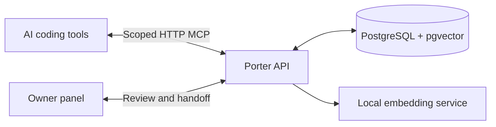

<div align="center">
  
  <h1>Porter</h1>
  <p><strong>Carry project context between AI coding tools.</strong></p>
  <p><a href="#quickstart"><strong>Quickstart</strong></a> · <a href="#architecture">Architecture</a> · <a href="README.zh-CN.md">中文</a></p>
</div>

**Self-hosted alpha** · Python 3.12+ · FastAPI · PostgreSQL + pgvector

When you switch from Codex to OpenCode, project decisions usually stay in the old chat. Porter gives your tools a shared place to save and retrieve those decisions through MCP, with a review inbox and separate permissions for each client.

## Features

- **Save and find context.** Store project decisions and conventions, then search by meaning or narrow the results with tags.
- **Review what gets shared.** Sensitive or conflicting writes go to the owner inbox. Strict mode queues every new write.
- **Grant limited access.** Give each client revocable OAuth credentials for read, write, or tag-restricted read.
- **Hand off a project.** Export a briefing from the owner panel, or back up the store with a signed snapshot.

## See it in use

In the [native-client test](docs/NATIVE_CLIENT_ACCEPTANCE.2026-10-22.md), **Codex saved a synthetic project memory** and **OpenCode found the same record in a fresh conversation**. OpenCode had a separate read-only credential. The test also confirmed that a work-scoped client could not retrieve the private fixture.

The panel can turn saved context into a shareable briefing. [See the handoff screen with synthetic data](assets/dsh-handoff-acceptance.2026-10-25.png) (Chinese UI).

## Architecture



This alpha is designed for a single owner. Assistants call MCP tools explicitly, and standard memories are stored in plaintext on your server. See the [security policy](SECURITY.md) for the deployment boundary.

## Quickstart

Requires Git, Python 3.12+, and Docker with Compose 2.24.4+. The first launch downloads images and a model whose measured cache is about 3.8 GB.

```bash
git clone https://github.com/Mike-Animal-Counseling/porter.git
cd porter
python scripts/setup_local.py
docker compose up --build -d
docker compose ps
```

Open [the local panel](http://127.0.0.1:8000/panel) once the services are healthy. If prompted to unlock, use `Open-Porter.cmd` on Windows or run `python scripts/open_panel.py --lang en` on macOS/Linux.

Follow the [deployment guide](DEPLOY.md) to connect your first HTTP MCP client. The [connection checklist](docs/USER_SETUP_CHECKLIST.md) walks through a save and retrieval test.

## Documentation

- [Developer guide](docs/DEVELOPER.md) and [protocol specification](SPECS.md)
- [Acceptance criteria and test evidence](docs/ACCEPTANCE.md)
- [Contributing](CONTRIBUTING.md) and [maintainer guide](docs/MAINTAINERS.md)

[MIT license](LICENSE) · [Third-party components](THIRD_PARTY.md)
