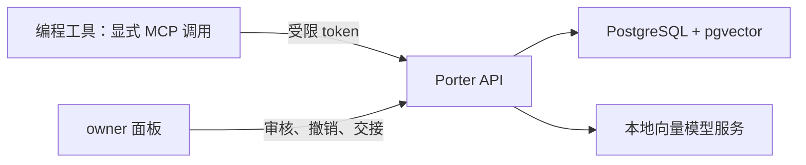

<p align="center">
  <a href="README.md">English</a> &nbsp;|&nbsp; <a href="README.zh-CN.md"><b>中文</b></a>
</p>

<h1 align="center">Porter</h1>
<p align="center">在 AI 编程工具之间，带走你的项目上下文。</p>
<p align="center">
  <a href="LICENSE"></a>
  
  
</p>

**Porter 是面向 AI 编程助手的自托管记忆服务。** 把项目决策、约定和偏好保存下来，
通过 MCP 从另一个工具检索，或导出交接简报。数据库、审批和每个客户端的访问权限由你掌控。

Porter 提供工具接口和配置模板。接入 MCP **不会自动抓取聊天、后台同步，或在每次提问时
自动注入记忆**；需要助手主动调用工具，或由适配器实现这些流程。仓库提供 27 个工具的
配置模板，这不代表 27 个真实客户端都已验收。

## 可以做什么

- **共享项目上下文：** 用 `project:<name>` 标签保存 `project` 记忆，检索或在
  `/panel/handoff` 生成中英文交接简报。
- **控制何时生效：** 默认分级审批允许低风险写入直接生效，极相似的项目记忆可能合并；
  个人、敏感或冲突的候选内容进入审核队列。设置 `PORTER_APPROVAL_MODE=strict` 可以审核
  所有新增写入。以返回状态为准，不要假定写入已经生效。
- **限制客户端权限：** OAuth token 支持读取、写入和按标签限读，提供撤销和审计。
  优先使用 HTTP MCP，客户端只需要自己的 token。
- **检索与迁移：** PostgreSQL/pgvector 语义搜索、支持格式的记忆文件一次性导入，
  以及供适配器开发者使用的增量同步接口。
- **备份与检查：** 签名快照可选密码加密，恢复后进入审核队列，提供中英文管理面板。

普通记忆以明文存储在你的服务器上。可选的客户端加密记忆格式不参与向量化或语义搜索，
并不会让普通写入自动变成端到端加密。工作区角色和设备密钥封套属于早期基础能力，
尚不是完整的多用户服务。

## 组成与数据流



## 快速开始

准备 Docker Engine/Desktop、Compose **2.24.4+**、Git 和 Python **3.12+**。
Python 用来运行初始化脚本；通过 HTTP 接入不需要本地安装 Python 包。
Docker 运行 API/面板、PostgreSQL/pgvector 和本地 BGE-M3 向量模型服务。

```bash
git clone https://github.com/Mike-Animal-Counseling/porter.git
cd porter
python scripts/setup_local.py
docker compose up --build -d
docker compose ps
```

打开 **http://127.0.0.1:8000/panel**。出现登录提示时，使用本地 `.env` 中的
`PORTER_SETUP_TOKEN` 解锁。初始化脚本生成稳定的随机凭据；已有 `.env` 会保留，
缺失项请参照 [`.env.example`](.env.example) 补齐。不要分享或提交该文件。

首次启动需要联网下载镜像、Python 依赖和模型。实测 BGE-M3 模型缓存约 **3.8 GB**，
镜像还需要额外磁盘空间。支持 CPU 推理；Compose 将模型容器内存上限设为 **4 GB**，
数据库、API 和 Docker 还需要额外内存。这些是实测或配置数值，不是对整机最低配置的保证。
首次下载时间取决于网络。

启动较慢时，查看 `docker compose logs --tail 50 embedder api`，等待服务健康且
`GET /healthz` 返回 200。不要靠删除数据卷解决启动问题。
[部署与排错指南](DEPLOY.zh-CN.md) 包含凭据、端口、模型下载和恢复说明。

接下来按照 [接入清单](docs/USER_SETUP_CHECKLIST.zh-CN.md) 先接入**一个**工具。
Codex 优先使用 [`clients/codex-http-config.toml`](clients/codex-http-config.toml)。
创建 OAuth 客户端，完成授权与 code 交换后使用 access token；client secret 不是
access token。token 一小时过期，需要刷新。HTTP 客户端不需要服务端 JWT 签名密钥或数据库密码。

## 适合谁

适合使用多个 AI 工具、希望明确控制共享记忆，并能运行本地 Docker 服务的开发者。
目前仍需要配置客户端并主动调用工具；尚不是零配置插件、完整聊天归档、托管团队产品，
也不能保证任意编程助手会自动记住上下文。

Ollama 提取器**可选，默认关闭**：客户端调用 `memory_capture` 时，它可以提出待人工审核的事实。
保存、检索和交接记忆都不依赖它。详见 [提取器说明](docs/EXTRACTION.zh-CN.md)。

## 状态与验收

**v0.1.0 alpha。** 2026-10-20 的检查记录为 **650 项本地测试通过，无跳过**，包括真实
PostgreSQL 和隔离 Docker 验收环境；OAuth、HTTP/stdio MCP、加密恢复及 API 容器重建后的
持久化均已验证。六项 CI 检查质量、打包、Linux/Windows 测试、PostgreSQL 和 Docker 部署。
最终候选版本的结果见 [PR #1](https://github.com/Mike-Animal-Counseling/porter/pull/1)、
[Actions](https://github.com/Mike-Animal-Counseling/porter/actions) 和
[检查报告](docs/REVIEW.zh-CN.md)。这些是有日期的验证记录，不代表所有客户端和部署环境都已测试。

发布前仍需完成你所用工具的真实对话，以及浏览器视觉和交互验收。BGE-M3 的小样本评估
也不是通用检索质量保证。[验收标准](docs/ACCEPTANCE.zh-CN.md) 列出了已完成项和少量
需要人工确认的步骤。如果正在验收尚未合并的 PR，请使用其来源分支；默认分支可能还没有这些修复。

## 文档与贡献

| 从这里开始 | 用途 |
|---|---|
| [接入清单](docs/USER_SETUP_CHECKLIST.zh-CN.md) | 连接实际工具，完成简短的合成数据验收 |
| [验收标准](docs/ACCEPTANCE.zh-CN.md) | 发布门槛、证据、负责人和剩余差距 |
| [部署指南](DEPLOY.zh-CN.md) | Docker、OAuth、接入模板、备份与排错 |
| [开发者指南](docs/DEVELOPER.zh-CN.md) | REST/MCP 契约与客户端集成 |
| [安全策略](SECURITY.zh-CN.md) | 信任边界、部署假设和私密漏洞披露 |
| [贡献指南](CONTRIBUTING.zh-CN.md) | 开发环境与必要检查 |
| [仓库规范](docs/REPOSITORY_STANDARDS.zh-CN.md) | 打包、CI、格式和依赖维护 |
| [维护者指南](docs/MAINTAINERS.zh-CN.md) | 发布检查、回退与仓库设置 |
| [依赖审计](docs/DEPENDENCY_AUDIT.zh-CN.md) · [界面检查](docs/UI_REVIEW.zh-CN.md) | 有日期的发现、修复与验证边界 |
| [更新记录](CHANGELOG.zh-CN.md) · [规格](SPECS.zh-CN.md) | 变更与设计目标；实际实现状态以上述记录为准 |

可复现的问题和功能建议请 [创建 issue](https://github.com/Mike-Animal-Counseling/porter/issues)，
提供提交版本、平台和去除敏感信息后的步骤；不要附上 token 或私人记忆。
安全问题按 [SECURITY.zh-CN.md](SECURITY.zh-CN.md) 处理。

## 许可

[MIT](LICENSE)。依赖与模型权重保留各自的授权条件，见[第三方组件](THIRD_PARTY.zh-CN.md)。
