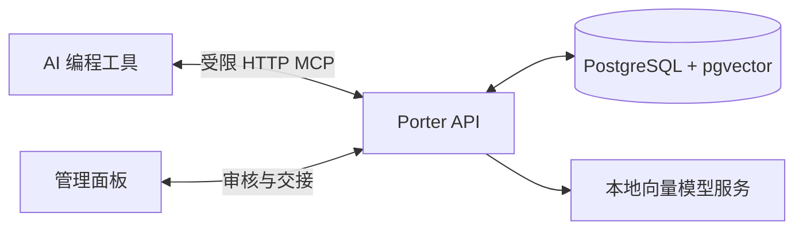

<div align="center">
  
  <h1>Porter</h1>
  <p><strong>在 AI 编程工具之间共享项目上下文。</strong></p>
  <p><a href="#快速开始"><strong>快速开始</strong></a> · <a href="#架构">架构</a> · <a href="README.md">English</a></p>
</div>

**自托管 Alpha** · Python 3.12+ · FastAPI · PostgreSQL + pgvector

从 Codex 切到 OpenCode 时，项目决策往往还留在原来的聊天里。Porter 让不同工具通过 MCP 保存和查找同一份上下文。你可以在收件箱审核写入，并为每个客户端单独设置权限。

## 功能

- **保存和查找上下文。** 保存项目决策与约定，按语义检索，也可用标签缩小范围。
- **审核共享内容。** 敏感或冲突的写入进入审核收件箱。严格模式下，每条新写入都需审核。
- **限制访问。** 为每个客户端授予可撤销的 OAuth 凭据，支持读取、写入和按标签限读。
- **交接与备份。** 从管理面板导出项目交接简报，或用签名快照备份记忆库。

## 实际怎么用

在[真实客户端验收](docs/NATIVE_CLIENT_ACCEPTANCE.2026-10-22.zh-CN.md)中，**Codex 写入一条合成的项目记忆**，**OpenCode 在新对话中找回同一条记录**。OpenCode 使用独立的只读凭据。测试还验证了仅有工作权限的客户端无法取回私密测试记录。

管理面板可以把已保存的上下文整理成交接简报。[查看使用合成数据的交接界面](assets/dsh-handoff-acceptance.2026-10-25.png)。

## 架构



当前 Alpha 面向单一所有者。助手需主动调用 MCP 工具，普通记忆以明文保存在你的服务器上。部署边界见[安全策略](SECURITY.zh-CN.md)。

## 快速开始

需要 Git、Python 3.12+ 和 Docker（Compose 2.24.4+）。首次启动会下载镜像和模型，实测模型缓存约 3.8 GB。

```bash
git clone https://github.com/Mike-Animal-Counseling/porter.git
cd porter
python scripts/setup_local.py
docker compose up --build -d
docker compose ps
```

服务健康后打开[本地面板](http://127.0.0.1:8000/panel)。如提示解锁，Windows 双击 `Open-Porter.cmd`，macOS/Linux 运行 `python scripts/open_panel.py`。

按[部署指南](DEPLOY.zh-CN.md)接入第一个 HTTP MCP 客户端。用[接入清单](docs/USER_SETUP_CHECKLIST.zh-CN.md)验证一次保存和检索。

## 文档

- [开发者指南](docs/DEVELOPER.zh-CN.md)和[协议规范](SPECS.zh-CN.md)
- [验收标准和测试记录](docs/ACCEPTANCE.zh-CN.md)
- [贡献指南](CONTRIBUTING.zh-CN.md)和[维护者指南](docs/MAINTAINERS.zh-CN.md)

[MIT 许可](LICENSE) · [第三方组件](THIRD_PARTY.zh-CN.md)
