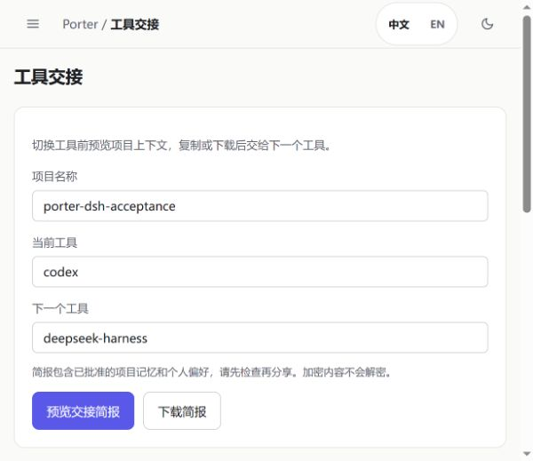

[English](DSH_ACCEPTANCE.2026-10-25.md) | **中文**

# DeepSeek Harness 原生验收 — 2026-10-25

**已通过：Codex 实际写入合成记忆，DeepSeek Harness 全新会话检索到同一 ID；
受限权限拒绝、独立凭据撤销，以及 API 重启后的继续读取也均已通过。**

本次使用官方桌面版自带的 CLI，不是用 HTTP 脚本模拟智能体。
没有修改官方应用文件；本记录不代表桌面 GUI 的 MCP 配置、自动抓取或 Harness 全部功能已验收。

## 环境与范围

| 组件 | 实测配置 |
|---|---|
| 写入端 | 原生 Codex CLI 0.160.0，HTTP MCP |
| 读取端 | 官方 DeepSeek Harness 桌面版内置 CLI 0.2.1-rc.3，独立 headless profile |
| 模型 | `deepseek-account` / `deepseek-flash`，使用保存的 DeepSeek 账号授权 |
| Porter | MCP 核心代码基线 `4e63fe9` 与本次候选的界面/模板更正，独立 PostgreSQL + pgvector，本机 HTTP MCP |
| 向量 | 确定性的 1024 维 `hash` 向量 |
| 读取权限 | 独立 Porter 凭据，仅有 `memory.read.work` |
| 模型 API key | 测试子进程移除了继承的 OpenAI、Anthropic 和 DeepSeek API key |

独立 headless 配置显式启用了受管凭据、授权与 DeepSeek 账号 provider，选择账号模型并加载 Porter MCP。
这些 provider 在默认 headless 配置中会被关闭，不能假定新建 headless profile 就会复用桌面登录。
本次测试配置关闭了文件、Shell、插件管理、网页及子智能体工具；只读沙箱与服务端受限凭据约束本次操作，
不代表操作系统完整隔离。测试子进程关闭了 Session Log 贡献与反馈遥测，没有改动用户桌面端的偏好。

hash 向量用于控制本次协议和持久化测试的资源占用，不用于证明语义检索质量。
此前真实 BGE-M3 的验证仍按日期单列，见 [已有验收记录](ACCEPTANCE.zh-CN.md)。

## 实际操作

所有记录均为虚构测试数据。提示词只提供查询标记，没有提供预期项目记忆 ID；
独立核对服务端 MCP 响应，不只依赖模型最终回答。

| 检查 | 实际结果 |
|---|---|
| Codex `memory_add` | active ID：`5ca86983-0035-4c22-be5f-81001fb329f8` |
| DSH 新会话 `memory_search` | 返回完全相同的 active ID |
| work 只读 DSH 搜索 `health` | 解码后的服务端响应为零条 |
| DSH 用已知私人 ID 请求关联信息 | 返回 `porter:not_found`；私人测试记录已批准且 active |
| work 只读 DSH 尝试 `memory_add` | 返回 `porter:insufficient_scope`；直接检查 PostgreSQL，所有状态均无对应写入 |
| 一次性 DSH 读取凭据撤销前 | 可检索同一项目 ID |
| 同一凭据撤销后 | JWT 尚未到期时，原生 MCP 连接收到 HTTP 401 `token_revoked`；没有执行 `tools/call` |
| API 重启后，原始 DSH 读取凭据 | 新会话仍取得原 ID，凭据没有重新创建 |

被撤销凭据对应的 CLI 在报告工具不可用后仍以零退出。
因此，撤销验证以真实 HTTP 拒绝及没有执行工具为依据，不把进程退出码当成授权成功的证明。

[去敏机器记录](dsh-acceptance.2026-10-25.json) 包含实际 MCP 调用与服务端检查。
原始日志、授权、token、数据库密码和模型账号信息不进入源码或构建包。

## Porter 浏览器检查

使用应用内浏览器检查了本机面板，截图宽度为 600 像素：全文搜索、记忆详情、复制反馈、
Escape 关闭抽屉并将焦点返回触发链接、中文切换、折叠导航，以及工具交接的预览、复制和下载。
下载文本实际包含项目标记与 Codex 到 DSH 的交接方向。

检查发现交接页三个输入框省略了 `type="text"`，导致现有文本输入框样式没有生效。
现已补齐类型，使这些控件采用已有的全宽表单样式。



这是限定范围的交互检查。完整桌面/手机、触摸、读屏与跨浏览器检查，以及 owner 最终签收仍待完成；
不能只凭这张截图关闭这些门槛。

## 自动验证

- 配置真实 PostgreSQL 与运行中的 HTTP/stdio 服务后的最终全量测试：**672 通过，1 跳过**，
  包括持久化、权限/回滚、OAuth、HTTP/stdio MCP 和加密快照检查。
- 输入框修正后的面板、交接和可访问性回归：**73 通过**；这些用例也包含在最终全量测试中。
- 可选 Ollama 模型没有配置；手动记忆操作和本次真实跨工具流程不依赖它。
- Ruff、格式、依赖一致性、pre-commit 配置及本地仓库检查通过。
  最终候选仍需核对其准确提交对应的 CI，不能用历史 CI 代替。

## 连接配置

对已经配置好的 DSH profile，可插入下面的 MCP 条目：

```yaml
- insert:
    - id: mcp-porter
      name: '@deepseek-ai/dsh-mcp-client'
      config:
        serverName: porter
        transport: streamable-http
        url: http://127.0.0.1:18010/mcp
        headers:
          Authorization: !!js "'Bearer ' + process.env.PORTER_TOKEN"
        toolCallTimeoutMs: 60000
        failOnStartupError: true
```

URL 应匹配自己的部署，标准 Compose 使用 8000 端口。
通过子进程环境提供独立、最小权限的 Porter OAuth access token，凭据不能进入 Git。
通过 `--patch` 将私有覆盖层应用到独立 profile；保留已有桌面配置，单独处理 headless 的账号设置。
access token 续期和每个客户端的配置仍由部署方负责。
